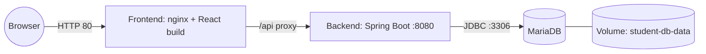

# Student Registration App: Docker, Compose and Kubernetes (EKS)

Deployment of a three-tier student registration app on AWS, done three ways:

1. **Docker Compose** on a single EC2 instance (database in a container, no RDS)
2. **Plain Docker commands** on EC2 (the same result, step by step)
3. **Kubernetes on Amazon EKS** (with either in-cluster MariaDB or Amazon RDS)

This repository holds the **deployment work**: Dockerfiles, Compose file, Kubernetes manifests and helper scripts. The application itself (React frontend and Spring Boot backend) belongs to its original author, [prathamnandgirwar/student-app-k8s](https://github.com/prathamnandgirwar/student-app-k8s). It is downloaded at build time by `scripts/fetch-app.sh` and is not copied into this repo.

## Architecture



| Tier | Technology | Container |
|---|---|---|
| Frontend | React + Vite, served by nginx | `student-frontend` |
| Backend | Spring Boot 3.3.5, Java 17, Spring Data JPA | `student-backend` |
| Database | MariaDB 11.4, data on a named volume | `db` |

The browser only talks to the frontend on port 80. nginx forwards `/api/...` to the backend, so **the backend is never exposed to the internet** and the frontend image contains no server IP.

## Repository layout

```text
.
├── docker-compose.yml        # Option 1: whole stack with one command
├── .env.example              # copy to .env and set passwords
├── docker/
│   ├── backend.Dockerfile    # multi-stage build, non-root runtime
│   ├── frontend.Dockerfile   # multi-stage build, nginx runtime
│   ├── nginx.conf.template   # static files + /api proxy
│   └── run-with-docker.sh    # Option 2: plain `docker run` version
├── k8s/                      # Option 3: Kubernetes manifests (EKS)
│   ├── eks-cluster.yaml      # eksctl cluster definition
│   ├── namespace.yaml
│   ├── secret.example.yaml   # template; real secret is git-ignored
│   ├── mariadb.yaml          # optional in-cluster database
│   ├── backend.yaml
│   └── frontend.yaml
└── scripts/
    ├── install-docker.sh     # Docker + Compose on Ubuntu
    ├── install-eks-tools.sh  # AWS CLI, kubectl, eksctl
    ├── fetch-app.sh          # downloads the application source into ./app
    └── build-push.sh         # builds images and pushes them to Docker Hub
```

---

## Option 1: Docker Compose on EC2 (no RDS)

**EC2 setup:** Ubuntu instance, security group allowing **port 80** from anywhere and **port 22 from your IP only**. Port 8080 and 3306 stay closed.

```bash
# 1. Install Docker and Compose
git clone https://github.com/ankit-logs/student-app-devops.git
cd student-app-devops
bash scripts/install-docker.sh
newgrp docker                      # or log out and back in

# 2. Get the application source
bash scripts/fetch-app.sh

# 3. Set passwords (kept out of git)
cp .env.example .env
nano .env

# 4. Build and start everything
docker compose up -d --build
docker compose ps                  # all three services should become "healthy"
```

Open `http://<ec2-public-ip>/` to see the registration form.

Check that registrations are stored:

```bash
docker exec -it db mariadb -u admin -p student_db
# at the prompt:  SELECT * FROM user;
```

Stop and clean up:

```bash
docker compose down        # removes containers, keeps the database volume
docker compose down -v     # also deletes the stored data
```

## Option 2: plain Docker commands

This is the same deployment without Compose: it creates the network and volume, starts MariaDB with a health check, then builds and runs the backend and frontend.

```bash
bash scripts/install-docker.sh && newgrp docker
bash scripts/fetch-app.sh
cp .env.example .env && nano .env

bash docker/run-with-docker.sh up        # build and start
bash docker/run-with-docker.sh down      # remove containers (data kept)
bash docker/run-with-docker.sh purge     # remove containers and data
```

## Option 3: Kubernetes on Amazon EKS

> **Cost warning:** EKS charges for the control plane, the worker nodes and the load balancer. Delete the cluster as soon as you finish (see Clean up).

**1. Admin machine and cluster**

```bash
bash scripts/install-eks-tools.sh
aws configure                                    # or attach an IAM role to the machine
eksctl create cluster -f k8s/eks-cluster.yaml    # takes roughly 15 to 20 minutes
```

`eksctl` configures `kubectl` automatically. If you need to reconnect later: `aws eks update-kubeconfig --name student-app --region ap-south-1`.

**2. Build and push the images** (needs Docker on the same machine)

```bash
bash scripts/install-docker.sh && newgrp docker
docker login -u <your-dockerhub-user>
DOCKERHUB_USER=<your-dockerhub-user> TAG=1.0.0 bash scripts/build-push.sh
```

Open `k8s/backend.yaml` and `k8s/frontend.yaml` and make sure the `image:` lines match your Docker Hub user and tag.

**3. Namespace and credentials**

```bash
kubectl apply -f k8s/namespace.yaml

cp k8s/secret.example.yaml k8s/secret.yaml       # git-ignored
nano k8s/secret.yaml                             # set real passwords
kubectl apply -f k8s/secret.yaml
```

**4. Database: pick one**

*A. MariaDB inside the cluster (no RDS)*

```bash
kubectl apply -f k8s/mariadb.yaml
kubectl -n student-app rollout status statefulset/mariadb
```

*B. Amazon RDS*

1. Create an RDS MariaDB or MySQL instance in the same VPC as the cluster.
2. Allow port 3306 from the node group's security group.
3. Connect with a MariaDB client from a node or an EC2 instance in that VPC and prepare the database:

   ```sql
   CREATE DATABASE IF NOT EXISTS student_db;
   -- only if you use a separate (non-master) user:
   GRANT ALL PRIVILEGES ON student_db.* TO 'admin'@'%';
   FLUSH PRIVILEGES;
   ```

4. In `k8s/secret.yaml`, set `SPRING_DATASOURCE_URL` to `jdbc:mariadb://<rds-endpoint>:3306/student_db?sslMode=trust` and the matching username and password.

The application creates its own table on first start (`ddl-auto=update`), so no manual `CREATE TABLE` is needed.

**5. Deploy the application**

```bash
kubectl apply -f k8s/backend.yaml
kubectl apply -f k8s/frontend.yaml

kubectl -n student-app get pods
kubectl -n student-app get svc frontend-svc      # wait for EXTERNAL-IP (a DNS name)
```

Open `http://<EXTERNAL-IP>/`. The load balancer DNS name can take a few minutes to start answering.

Useful commands:

```bash
kubectl -n student-app logs deploy/backend
kubectl -n student-app describe pod <pod-name>
kubectl -n student-app scale deploy/backend --replicas=3
```

**Clean up**

```bash
kubectl delete -f k8s/frontend.yaml              # removes the AWS load balancer first
kubectl delete -f k8s/backend.yaml
kubectl delete -f k8s/mariadb.yaml               # if you used in-cluster MariaDB
eksctl delete cluster -f k8s/eks-cluster.yaml
```

Also delete the RDS instance if you created one.

---

## Configuration reference

| Setting | Where | Meaning |
|---|---|---|
| `DB_NAME`, `DB_USER`, `DB_PASSWORD`, `DB_ROOT_PASSWORD` | `.env` (Compose and `run-with-docker.sh`) | Database name and credentials |
| `SPRING_DATASOURCE_URL` / `_USERNAME` / `_PASSWORD` | container environment, or `db-credentials` secret in Kubernetes | Override the backend's database settings. The app's own `application.properties` is never edited |
| `BACKEND_HOST`, `BACKEND_PORT` | frontend container environment | Where nginx forwards `/api`. `backend:8080` in Compose, `backend-svc:8080` in Kubernetes |
| `VITE_API_URL` | frontend build argument (default `/api`) | URL the browser uses for the API |

## What is different from a basic class setup

| Basic setup | Here | Why |
|---|---|---|
| Passwords typed into commands and edited into `application.properties` | Passwords in `.env` or a Kubernetes Secret, passed as environment variables | Nothing sensitive is committed or shown in screenshots |
| `chmod 777 /var/run/docker.sock` | User added to the `docker` group | The 777 shortcut lets any local user control Docker, and so the host |
| Frontend built with the server IP baked in | Frontend calls `/api` and nginx proxies it | One image works on EC2, EKS or locally, and no rebuild when the IP changes |
| Backend port 8080 open to the internet | Backend reachable only inside the network | Smaller attack surface |
| Backend built and run in the Maven image as root | Multi-stage build, small JRE image, non-root user | Smaller image, safer runtime |
| `latest` tags | Versioned tags (`1.0.0`) | Reproducible deployments |
| Single replica, no probes | 2 replicas, startup, readiness and liveness probes, resource limits | Rolling updates without downtime and basic self-healing |

## Troubleshooting

| Symptom | Fix |
|---|---|
| `mysql: command not found` inside the `db` container | The MariaDB image names its client `mariadb`. Use `docker exec -it db mariadb -u admin -p student_db` |
| Backend restarts and logs show a connection error | The database is not ready or the credentials do not match. Check `docker compose logs db backend` |
| Frontend shows an empty table or network errors | Check `docker compose logs frontend backend`. The backend must be healthy first |
| `docker: permission denied` right after installing | Log out and back in, or run `newgrp docker` |
| Kubernetes pod `Pending` | `kubectl describe pod`. For MariaDB it usually means the EBS CSI add-on is missing |
| `EXTERNAL-IP` stays `<pending>` | Wait a few minutes. If it persists, check the Service events with `kubectl describe svc` |

## Security notes

- Never commit `.env` or `k8s/secret.yaml`. Both are in `.gitignore`.
- If a password was ever shown in a screenshot, slide or commit, treat it as exposed and change it.
- For anything beyond learning, add HTTPS (an Application Load Balancer with an ACM certificate) and use AWS Secrets Manager instead of plain Kubernetes Secrets.

## Credits and license

- Application (React + Spring Boot): [prathamnandgirwar/student-app-k8s](https://github.com/prathamnandgirwar/student-app-k8s). The author has not published a license, so the source is fetched at build time rather than copied here.
- Deployment files in this repository: MIT, see [LICENSE](LICENSE).
